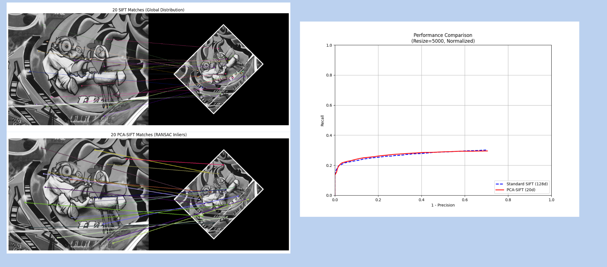
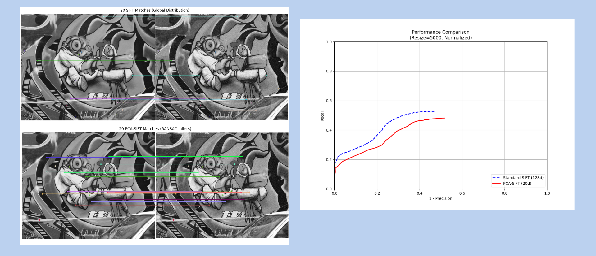
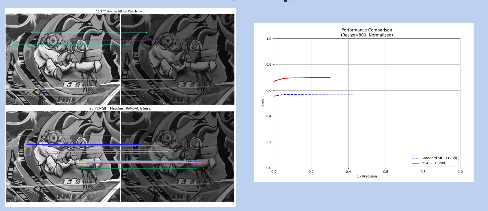

# PCA-SIFT 方法重現與 SIFT 特徵比較

計算機視覺課程的四人團隊專題，以 Python 實作 PCA-SIFT 的局部梯度描述子與 PCA 降維流程，並在報告中比較標準 SIFT 與 PCA-SIFT 在旋轉／縮放、雜訊及亮度變化下的影像匹配表現。本倉庫整理原課程程式與報告成果，供作品集檢視。

## 個人參與與合作方式

我參與初步程式除錯、後續實驗測試與資料整理，協助檢查結果並整理觀察。演算法實作、實驗及報告為四人合作成果；本倉庫不將所有模組歸為我個人獨立撰寫。

## 方法與實作

1. 以 SIFT 流程建立關鍵點、尺度與方向。
2. 擷取方向對齊的 41 × 41 區域，以水平及垂直梯度建立 3042 維向量。
3. 進行 L2 正規化，訓練 PCA 並投影為低維描述子。
4. 使用 FLANN 最近鄰匹配、0.7 距離比值篩選及 RANSAC 單應性估計，展示影像對應。

技術：Python、OpenCV、NumPy、Scikit-learn PCA、Matplotlib、Joblib。

## 報告中的實驗成果

以下圖片取自原課程報告，使用 20 維 PCA-SIFT 與 128 維 SIFT。附檔示範程式目前載入 36 維模型；這些報告圖並非以目前倉庫重新執行所產生。

### 旋轉與縮放

旋轉並縮小 50% 的測試中，兩種方法的曲線接近。



### 高斯雜訊

報告設定 sigma = 0.05；此條件下 SIFT 的匹配表現較佳，與原先認為 PCA 降維可能更抗雜訊的預期不同。



### 亮度變化

亮度減半的測試中，報告觀察到 PCA-SIFT 的曲線較佳。



報告以 Recall 對 1-Precision 比較；橫軸為錯誤匹配比例，不應直接當成分類問題的 false positive rate。20 維較 128 維減少約 84.4% 的元素數，不能據此宣稱整體記憶體或執行時間改善同樣比例。上述結果僅代表報告中的測試條件。

## 檔案配置

```text
pca_sift/       梯度描述子、特徵抽取、PCA 訓練與模型裁切
sift/           SIFT 基礎實作
experiments/    SIFT 與 PCA-SIFT 匹配示範
evaluation/     原附檔的評估模組占位檔，目前未實作
matching/       原附檔的匹配模組占位檔，目前未實作
data/raw/       示範使用的 box.png 與 box_in_scene.png
data/models/    原附檔的 6、8、10、12、16、20、28、36 維模型
docs/           原報告的實驗成果圖
```

原壓縮檔另有 40 張訓練 JPG、40 份 3042 維梯度特徵快取、完整 PCA 模型及其他素材；這些未放入本展示版。重新訓練需另外準備資料。

## 示範執行方式

在專案根目錄準備 Python 環境並安裝依賴，再執行：

```bash
python -m pip install -r requirements.txt
python -m experiments.run_sift
python -m experiments.run_pca_sift
```

需要支援圖形視窗的本機環境，程式以 Matplotlib 顯示匹配結果。原環境未附依賴版本紀錄，`requirements.txt` 是依程式匯入項目整理，尚未鎖定或驗證版本相容性。模型亦需與 Scikit-learn／Joblib 版本相容。

若希望示範使用報告的 20 維模型，可將 `experiments/run_pca_sift.py` 的模型路徑由 `pca_sift_36d.pkl` 改為 `pca_sift_20d.pkl`；此變更仍不足以重現報告中的合成變換及比較曲線，需補齊評估程式。

## 已知限制與後續工作

- 程式以原附檔版本保留，已檢查 Python 語法；尚未完成目前環境中的執行與結果重現驗證。
- 報告提及金字塔索引與座標縮放的修正，但目前附檔仍需對照正確版本。邊界取樣跳過描述子時，亦需檢查關鍵點與描述子索引的一致性。
- `evaluation/metrics.py`、`evaluation/plot_curves.py` 與 `matching/matcher.py` 是空檔，不能據此宣稱包含完整評估流程。
- 特徵抽取腳本目前指定 `12.jpg`、`14.jpg`、`32.jpg`；重建訓練資料時需確認影像清單。
- 訓練腳本的完整模型存在性檢查使用 `MODEL_DIR + "pca_sift_full.pkl"`，需改為正確路徑後再訓練，以免重複重訓。
- 後續應統一維度、影像變換與評估參數，補齊比較腳本、測試資料及實際時間量測。

課程使用的基礎實作與影像素材不代表由我原創；詳細來源及各組員程式貢獻仍應依團隊紀錄補充。
